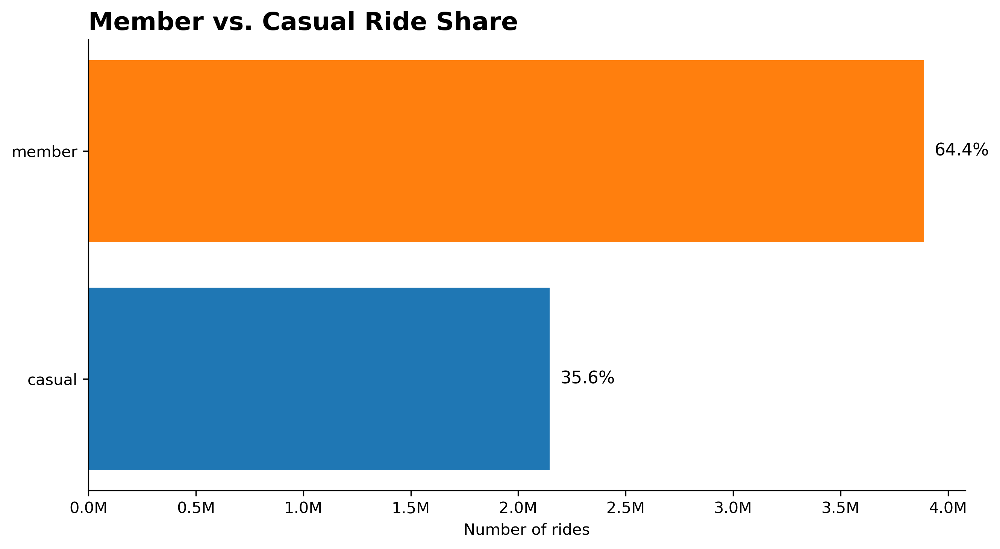
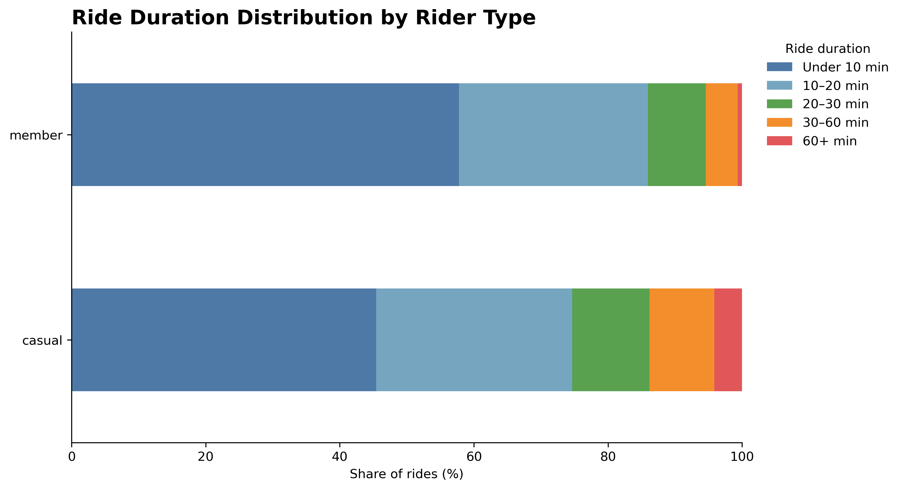
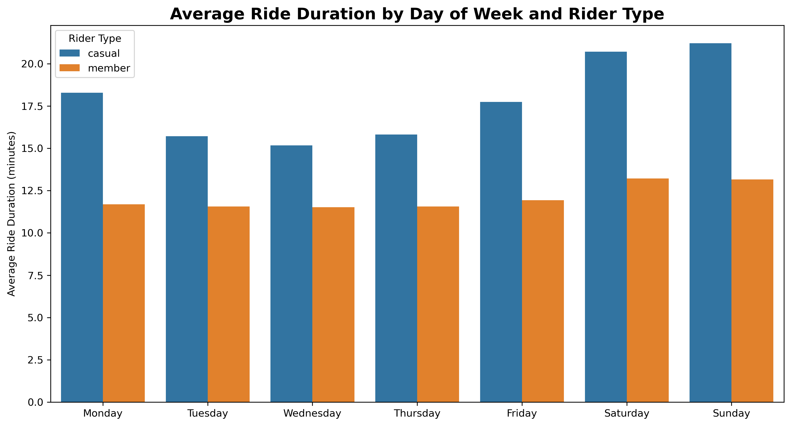
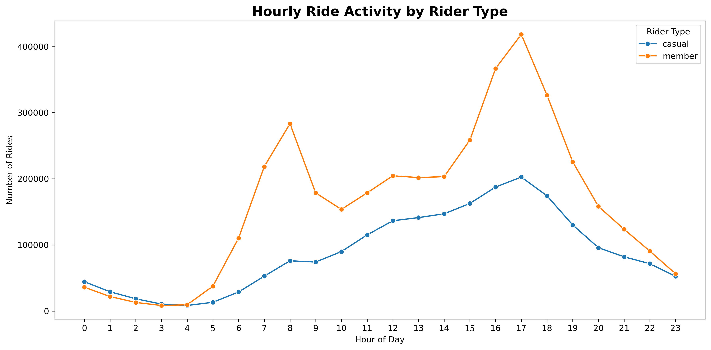
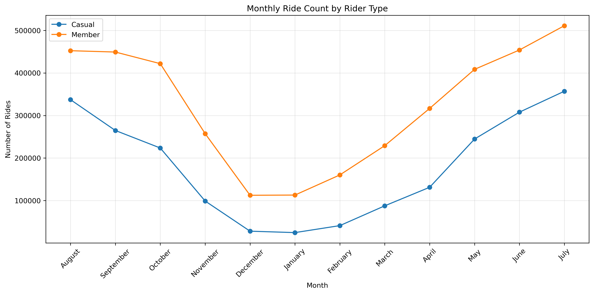
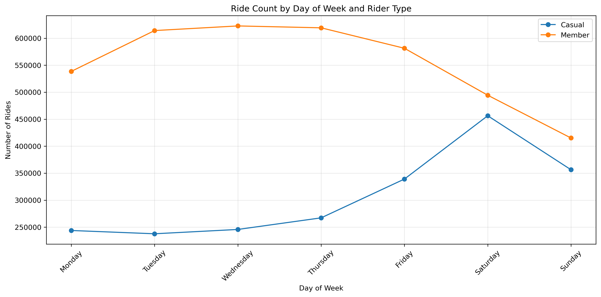
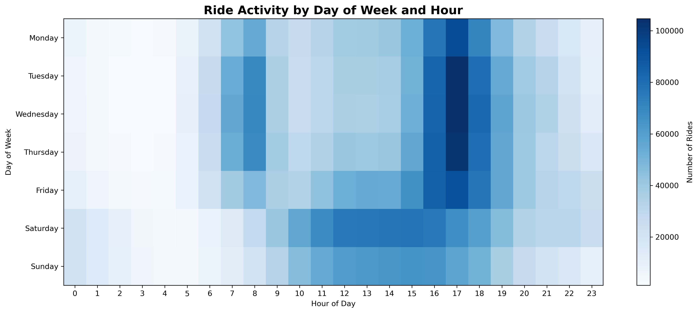
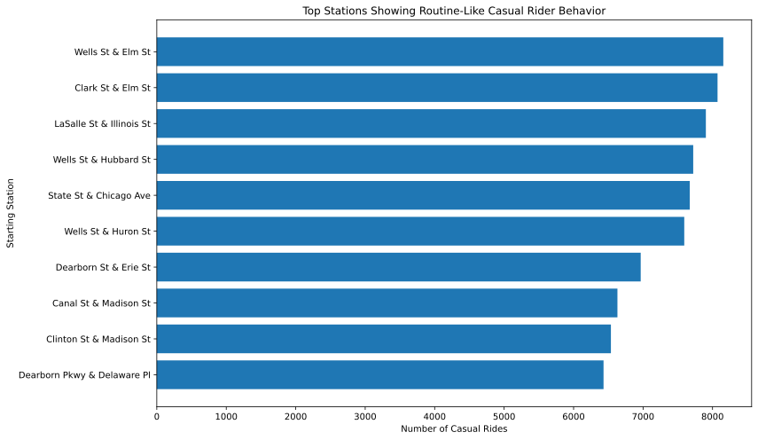
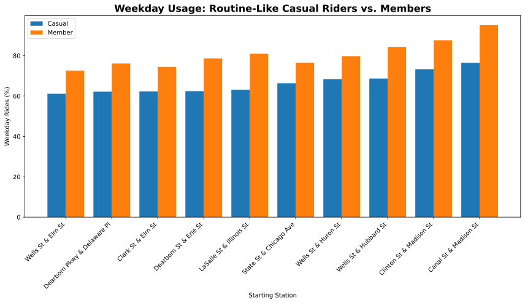

# Cyclistic Bike-Share Analysis

### Google Data Analytics Capstone Project

## Project Overview

For this project, I analyzed 12 months of Cyclistic bike-share data to understand how annual members and casual riders use the bike-share system differently.

The goal of the project was to identify differences in riding behavior and use those findings to recommend ways Cyclistic could encourage more casual riders to become annual members.

I used Python to clean, organize, and analyze approximately 6 million ride records. I then created visualizations to look at ride duration, time of day, day of week, monthly activity, and station usage.

One area I wanted to explore further was whether some casual riders were already using the system in ways that looked similar to annual members.

## 1. Ask – Business Task

Cyclistic is a bike-share company in Chicago. Its marketing team wants to increase annual memberships.

The company offers single-ride and full-day passes for casual riders, as well as annual memberships. The marketing team believes that understanding how casual riders use the service differently from annual members may help identify opportunities to increase memberships.

The main business question for this analysis was:

**How do annual members and casual riders use Cyclistic bikes differently?**

My goal was to analyze ride patterns across both customer groups and identify differences in ride duration, time of day, day of week, monthly activity, and station usage.

This analysis focuses on the first business question. It does not attempt to establish why individual casual riders would purchase a membership or measure the effectiveness of specific marketing campaigns.

## 2. Prepare – Data Sources

Historical trip data was downloaded from Divvy's publicly available bike-share dataset.

For this project, I used 12 monthly CSV files covering **August 2025 through July 2026**. The files were combined into one dataset for analysis.

The data includes information such as:

- Ride ID and bike type
- Trip start and end dates and times
- Start and end station names and IDs
- Start and end location coordinates
- Rider classification (member or casual)

The dataset provides trip-level information that makes it possible to compare riding patterns between members and casual riders.

The data is anonymized and does not identify individual customers. This means the analysis can compare trips and aggregate usage patterns, but cannot track individual riders over time or determine whether a specific casual rider later became a member.

**Data source:** [Divvy Historical Trip Data](https://divvybikes-marketing.lyft.net/system-data)

**Data license:** [Divvy Data License Agreement](https://divvybikes.com/data-license-agreement)

The original trip data is not included in this repository. Only the analysis, documentation, and visualizations are shared.

## 3. Process – Data Cleaning

The 12 monthly CSV files were imported into Python using pandas and combined into one dataset for analysis.

The data was reviewed and cleaned before beginning the analysis. The main steps included:

- Combined the 12 monthly files into one dataset.
- Checked for and removed 35 duplicate ride records.
- Converted the ride start and end timestamps into datetime format.
- Calculated ride duration in minutes using the start and end times.
- Removed trips with durations greater than 24 hours.
- Created additional columns for month, day of the week, hour, and weekday or weekend classification.
- Grouped ride durations into categories to compare riding patterns between casual riders and members.
- Reviewed missing station information and retained the available trip records for analysis.

After cleaning, the final dataset contained approximately 6 million rides (6,032,500 records).

Python, pandas, Matplotlib, and Seaborn were used throughout the cleaning and analysis process.

## 4. Analyze – What I Found

I looked at several areas to understand how the two rider groups use the system.

### Rider Type

Annual members accounted for approximately 64.4% of rides, while casual riders accounted for 35.6%.

Although members make up the larger share of rides, casual riders still represent a significant part of Cyclistic's customer base.

### Ride Duration

Casual riders generally take longer trips than members.

- Casual riders average approximately 18.3 minutes per ride.
- Annual members average approximately 12.0 minutes per ride.

This suggests that the two groups may be using the bikes for different purposes.

### Average Ride Duration by Day

Looking at average ride duration across the week helps show whether the difference between casual and member behavior changes depending on the day.

### Hourly Ride Activity

Hourly activity provides another way to compare the two groups.

Member activity shows stronger patterns around typical commuting hours, while casual usage has a different daily pattern.

### Monthly Ride Activity

Ride activity changes throughout the year, with stronger activity during warmer months.

Looking at monthly activity helps show the seasonal nature of bike-share usage.

### Day-of-Week Activity

Members show a stronger weekday pattern, while casual riders have a larger share of their activity on weekends.

This is one of the clearest differences between the two groups.

### Overall Ride Activity by Day and Hour

This heat map shows when the system experiences the most activity across the week.

It provides an overall view of demand and helps put the hourly and weekday findings into context.

## 5. Additional Analysis – Potential Membership Opportunities

I wanted to take the analysis a step further and look at where casual riders might already be using the system in ways that resemble annual members.

I focused on starting stations with:

- At least 5,000 casual rides.
- At least 60% of casual rides occurring on weekdays.
- At least 35% of casual rides occurring during selected morning and afternoon peak hours.
- Average weekday casual ride duration of 20 minutes or less.

These were screening criteria I selected for this analysis. They are not a proven formula for predicting whether someone will purchase a membership.

Using these criteria, I identified 20 stations for further review.

### Stations Showing Routine-Like Casual Usage

Some stations had a high number of casual rides along with weekday and peak-hour patterns that were worth investigating.

### Comparing Casual and Member Weekday Usage

I then compared casual and member weekday activity at these locations.

For example:

- Canal St & Madison St had 76.4% weekday casual activity, compared with 95.1% for members.
- Clinton St & Madison St had 73.2% weekday casual activity, compared with 87.7% for members.
- Wells St & Elm St had 61.2% weekday casual activity, compared with 72.6% for members.

These results show that some casual riders are using the system in patterns that are closer to member behavior than the overall casual rider averages might suggest.

These stations could be worth exploring for targeted membership marketing. However, the data does not identify individual riders or tell us whether these riders would actually purchase an annual membership.

## 6. Share – Key Takeaways

The analysis showed several differences in how casual riders and annual members use Cyclistic.

The main findings were:

- Members account for the majority of rides. Annual members made up approximately 64.4% of total rides, while casual riders accounted for 35.6%.
- Casual riders take longer trips. Casual rides averaged approximately 18.3 minutes, compared with 12.0 minutes for members.
- Members show stronger weekday usage. Their riding activity was more consistent with a routine weekly pattern, while casual riders had a larger share of weekend activity.
- Riding activity changes throughout the year. Both groups showed seasonal patterns, with higher usage during warmer months.
- Some stations show potential membership opportunities. The additional station analysis identified 20 locations where casual riding activity showed weekday and peak-hour patterns worth exploring.

Overall, the results suggest that casual riders and annual members use the same bike-share system in different ways. Understanding these differences could help Cyclistic develop more targeted membership marketing strategies.

## 7. Act – Recommendations

Based on the findings, I would recommend that Cyclistic explore the following opportunities:

1. Focus on Weekday Casual Riders

Some casual riders already use the system regularly during weekdays. Cyclistic could target these riders with messaging that highlights the convenience and potential savings of an annual membership.

2. Explore Membership Marketing at Key Stations

The station-level analysis identified 20 locations with relatively high casual weekday and peak-hour activity. These stations could be useful locations to test membership promotions or informational campaigns.

3. Highlight the Benefits of Annual Memberships

Marketing could focus on the convenience and value of membership for people who use the bikes frequently, rather than focusing only on recreational riding.

4. Test and Measure Marketing Campaigns

Cyclistic should test different messages and promotions before expanding a campaign. The company could compare membership sign-ups across targeted locations and campaign periods to see which approaches perform best.

These recommendations are based on aggregate riding patterns. Further research would be needed to understand individual customer motivations and determine which marketing strategies are most effective.

## Limitations

There are several limitations to consider when interpreting the results of this analysis.

- No individual customer information: The dataset does not identify individual riders, so it is not possible to track their behavior across trips or determine whether a casual rider later becomes an annual member.
- No customer motivations: The trip data does not explain why someone chooses a casual pass instead of an annual membership.
- Station information: Some trip records contain missing station information, which limits the amount of station-level analysis that can be performed.
- Seasonal influence: Bike-share activity is affected by weather and seasonal conditions. The patterns observed may change throughout the year.
- Exploratory screening criteria: The criteria used to identify potential membership opportunity stations were selected for this analysis. They have not been validated as predictors of membership purchases.
- No marketing campaign data: The analysis does not measure the effectiveness of advertising, promotions, or other marketing activities.

These limitations mean the findings should be viewed as an exploration of riding behavior rather than proof of what motivates casual riders to become members.

## Conclusion

This project allowed me to apply the data analysis process to a real-world business question using more than 6 million bike-share trips.

Using Python and data visualization, I was able to identify differences in how casual riders and annual members use Cyclistic. The analysis showed differences in ride duration, weekday and weekend activity, hourly patterns, and seasonal usage.

I also explored station-level riding patterns to identify locations that may offer opportunities for targeted membership marketing.

The project helped demonstrate how data cleaning, analysis, and visualization can turn large datasets into useful business insights.

Further analysis, including customer surveys and marketing campaign results, would help Cyclistic better understand what motivates casual riders to become annual members.

**Tools Used:** Python, Pandas, Matplotlib, Seaborn, Jupyter Notebook

**Project Type:** Google Data Analytics Capstone Case Study
